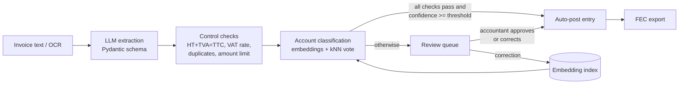

# Invoice Autopilot: automated bookkeeping of supplier invoices (MVP)

[](https://github.com/nmc2112/invoice-autopilot/actions/workflows/ci.yml)

Accountants still type most supplier invoices into the books by hand: read the invoice, pick the
expense account, check the VAT, post the entry. This MVP automates that process end to end and keeps a
human in the loop only where it matters.



> All invoices in this repository are **synthetic**, from fictional suppliers, and marked as test documents.

## What it does

| Step | How | File |
|---|---|---|
| Extraction | LLM in JSON mode, validated by a Pydantic model; one retry with the validation error; answers cached on disk (no tokens for repeated documents) | `extract.py`, `llm.py` |
| Controls | Deterministic: HT + TVA = TTC, allowed VAT rates, VAT amount vs rate, duplicate invoice, amount limit | `checks.py` |
| Classification | **Embeddings** of "supplier + description", cosine k-nearest-neighbour vote over labelled history, confidence score | `classify.py` |
| Decision | Auto-post only if every check passes **and** confidence ≥ threshold; otherwise human review | `pipeline.py` |
| Learning loop | Each approved or corrected invoice is added to the embedding index, so automation improves over time | `pipeline.py` |
| Posting | Balanced purchase entry: debit expense (HT) and deductible VAT 445660, credit supplier 401000 (TTC) | `ledger.py` |
| Export | FEC file (18 columns), ready for the accounting software or for the [Audit Copilot](https://github.com/nmc2112/audit-copilot) | `ledger.py` |
| Storage | SQLite: invoices, review queue, entries, examples | `store.py` |
| Interfaces | FastAPI service, Streamlit review UI, CLI | `api.py`, `app.py`, `cli.py` |

Everything that changes behaviour lives in `config/settings.yaml` (models, threshold, VAT rates, amount
limit, accounts) and `prompts/v1/` (versioned prompts).

## Quick start

```bash
python -m venv .venv && source .venv/bin/activate
python -m pip install -e ".[dev,ui]"

ollama pull qwen2.5:7b          # extraction
ollama pull nomic-embed-text    # embeddings (bge-m3 also works: change config)

python -m invoice_autopilot.synth --out data/invoices.jsonl -n 60
python -m invoice_autopilot.cli seed --n 80              # labelled history in the index
python -m invoice_autopilot.cli run data/invoices.jsonl  # process the batch
python -m invoice_autopilot.cli export --out data/export_fec.txt
```

Review UI: `streamlit run app.py` (http://localhost:8501). API: `uvicorn invoice_autopilot.api:create_app --factory`
then http://localhost:8000/docs.

Docker: `docker compose up --build` (API on :8000, UI on :8501, Ollama running on the host).

## Evaluation

```bash
python evals/run_eval.py            # real models from config/settings.yaml
python evals/run_eval.py --oracle   # ground-truth extraction + offline hashing embeddings (CI)
```

The eval seeds the index with labelled history, streams new invoices through the pipeline, and lets a
simulated accountant handle the review queue (approve with the right account, reject duplicates).

| Metric | Meaning |
|---|---|
| `extraction_field_accuracy` | Share of the 6 key fields extracted exactly |
| `account_accuracy` | Predicted expense account = true account |
| `automation_rate` | Share of invoices posted with no human action |
| `automation_rate_first_half` / `second_half` | Effect of the learning loop |
| `auto_posted_account_precision` | Accuracy of what was posted automatically (the risk metric) |
| `issues_caught` | Inconsistent, duplicate or above-limit invoices sent to review |

Pipeline check (`--oracle`, 40 history invoices, 61 streamed): account accuracy 0.87, automation rate 0.67
(0.57 in the first half, 0.77 in the second as corrections are learned), auto-post precision 0.90, issues
caught 7/7. These numbers use the offline hashing embedder; they validate the pipeline, not the models.

Results with local models (Intel i9 CPU, no GPU), 36 history invoices, 31 streamed, threshold 0.75:

| Models | Field accuracy | Account accuracy | Automation | Auto-post precision | Issues caught | Avg latency | Avg tokens |
|---|---|---|---|---|---|---|---|
| qwen2.5:7b + nomic-embed-text | 99.5% | 87.1% | 35.5% | 100% (11/11) | 5/5 | 31.7 s | 739 |

Reading: extraction is near perfect and nothing was posted to a wrong account, but the system is
conservative: 87% of account predictions are right while only 35% clear the 0.75 threshold. The eval
prints a threshold sweep (automation vs auto-post precision) to choose the threshold from data, and
extraction answers are cached (`llm.cache_path`), so comparing embedding models or thresholds does not
call the LLM again.

## Tests and CI

`ruff check . && mypy src app.py && pytest` — 22 tests run offline with a scripted LLM and the hashing
embedder: LLM and embedding clients (retries, batching), extraction retries, each control check, classifier accuracy and learning, balanced entries,
FEC export, review rules, and the API end to end. GitHub Actions also runs the oracle eval and builds the
Docker image with a health check.

## Limitations and next steps

- Input is invoice text (OCR output); PDF/image OCR is not included.
- One expense line per invoice; multi-line invoices and analytic accounts are not handled.
- Threshold and history size trade automation against risk: tune them on real, labelled data.
- Next: OCR step, multi-line invoices, confidence calibration, tracing with Langfuse.
# invoice-autopilot
